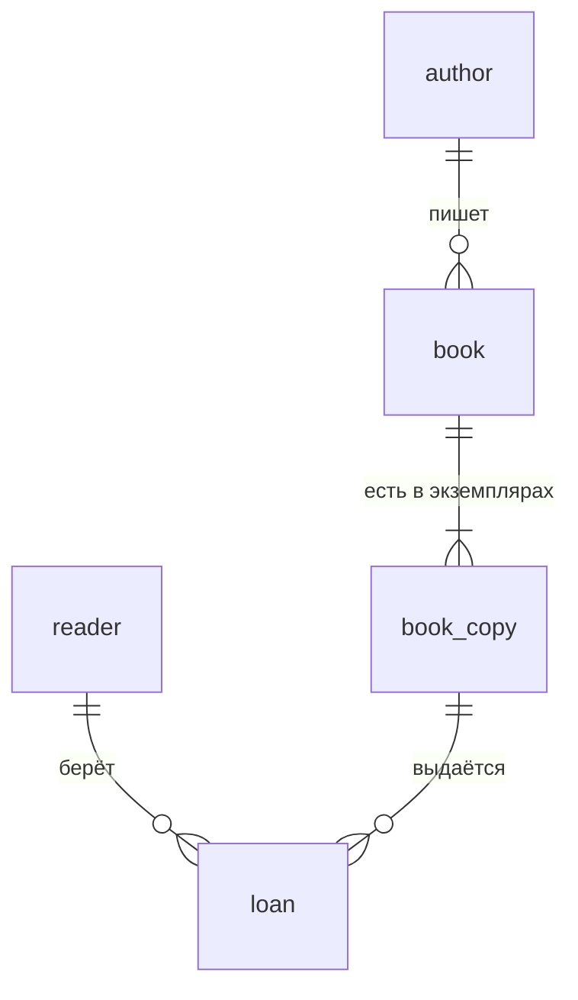
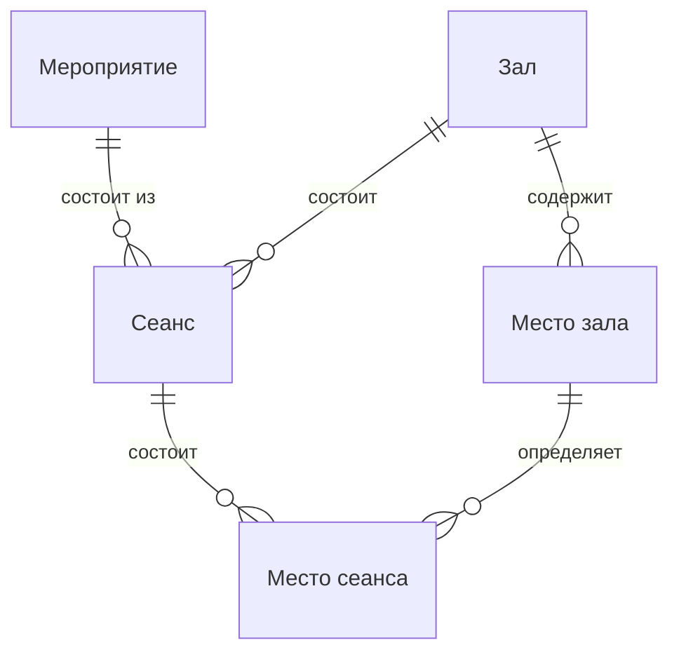

# Обзорная ER-диаграмма

Шаг 0 перед срезами (№66). Только сущности и связи, без колонок: колонки, индексы и ограничения добавляются в своём срезе.

## Как это рисуется (справка)

ER-диаграмма отвечает на два вопроса: **какие сущности есть** (будущие таблицы) и **как они связаны** — сколько строк одной сущности приходится на строку другой. Пример не из нашего домена — библиотека:

Значки на концах линии читаются **от сущности наружу**, у каждой стороны свой:

| Значок | Значит |
|---|---|
| `\|\|` | ровно один |
| `o\|` | ноль или один |
| `}\|` | один или много |
| `}o` | ноль или много |

`author ||--o{ book` читается в обе стороны: у книги **ровно один** автор, у автора **ноль или много** книг. В DDL это превратится во внешний ключ: колонка `author_id` у `book`. **Ключ всегда лежит на стороне «много».**

Отдельная сущность `loan` появилась потому, что связь «читатель — экземпляр» — это «многие ко многим», да ещё со своими данными (когда выдали, когда вернули). Такую связь нельзя положить колонкой ни в одну из двух таблиц.

Имена сущностей пиши латиницей в единственном числе — это будущие имена таблиц.

## Продукт

С 2026-11-23 продукт — сайт одного кинотеатра (№67): зал с креслами — зал и места зала; фильм — мероприятие; фильм в зале в 19:30 — сеанс; кресло на конкретный сеанс (свободно / в резерве / продано) — место сеанса; билет на 7-й ряд на 19:30 — билет. Всё заводит админ кинотеатра, организаторов нет.

## Сущности

Всё, что ниже, ты уже решил в журнале — я только собрал. Строки с «?» — пробелы: решить, нужна ли сущность и как она называется.

| Сущность | Имя | Откуда |
|---|---|---|
| Пользователь (покупатель, админ, контролёр) | `?` | ответ 2, №26 — ? В5 |
| Зал | `hall` | №6, №7 |
| Место зала | `?` | №6, №20 |
| Мероприятие (фильм) | `?` | №13, №67 |
| Сеанс | `session` | №13 |
| Место сеанса | `?` | №20, №21 |
| Тариф | `?` | №8, №29 — ? В3 |
| Позиция заказа (заказ, место, держатель, тариф) | `?` | №29, В3а |
| Тариф сеанса (сеанс, вид тарифа, цена) | `?` | В3б |
| Роль; пользователь — роль | `?` | В5а |
| Заказ | `order` | №20, №46 |
| Попытка оплаты | `payment_attempt` | №34, №41 |
| Журнал webhook | `?` | №32, №34 |
| Билет | `ticket` | №55 |
| История продаж и возвратов | `?` | №20, №30, №59 — ? В4 |
| Возврат | `refund` | №53, №61 |
| Outbox | `outbox` | №40 |
| ? | | что ещё нужно — может, найдёшь сам |

## Связи

Заполни «?»: кардинальность в нотации выше и одну фразу «почему». Порядок от простого к сложному.

| Связь | Кардинальность | Почему |
|---|---|---|
| зал — место зала | один ко многим | место зала не может принадлежать другому залу |
| мероприятие — сеанс | один ко многим | сеанс - единичный экземпляр проведенного мероприятия, по смыслу |
| зал — сеанс | один ко многим | |
| сеанс — место сеанса | один ко многим | |
| место зала — место сеанса | один ко многим | место зала может быть использовано для разных сеансов, тогда это будут разные места сеансов, привязанные к одному месту зала |
| пользователь (покупатель) — заказ | один ко многим | заказ принадлежит покупателю |
| заказ — место сеанса | один ко многим | в одном заказе может быть несколько мест |
| заказ — попытка оплаты | один ко многим | один заказ можно попытаться оплатить N раз - N-1 неудачных попыток и 1 удачная |
| заказ — билет | один ко многим | аналогично `заказ - место сеанса` |
| место сеанса — билет | один к одному (у места — ноль или один) | место сеанса - действующий билет; возвращённый удаляется (№59) |
| сеанс — тариф | ХХХ ? В3 | тариф - свойство билета, не сеанса |
| попытка оплаты — возврат | один ко многим (у попытки — ноль или много) | провайдер возвращает по id платежа попытки (№53); возвратов по одному платежу несколько (№61) |
| возврат — история | один ко многим (у записи — ноль или один возврат) | один возврат — по строке «возвращено» на каждое вернувшееся место; у записей «продано», «снято с резерва» возврата нет |

Когда таблица заполнена, нарисуй по ней `erDiagram` ниже.

(Строка-пример нужна, чтобы блок рендерился. Поправь кардинальность, если считаешь иначе.)

## Обсуждение

Раунд 1 (2026-11-23) — вопросы В1–В5 к каркасу. Раунды 2–4 (2026-11-23) — тема **«считаем с обеих сторон»** (закрыта). Раунды 5–6 — **кто на кого ссылается**: В2, В3, В5: в каждой связи вопрос «сколько?» задаётся дважды, от каждой сущности.

### Принято в раунде 2

- зал — место зала: один ко многим.
- мероприятие — сеанс: один ко многим.
- сеанс — место сеанса: один ко многим.
- покупатель — заказ: один ко многим.
- заказ — попытка оплаты: один ко многим. Уточнение к «почему»: успешной попытки может и не быть (заказ отменён), так что «N−1 неудачных и 1 удачная» — частный случай.
- заказ — билет: один ко многим.
- заказ — место сеанса: один ко многим — принято как «текущий резерв», вернёмся в В2: за жизнь сеанса одно место бывает в нескольких заказах (резерв истёк, возврат и перепродажа).

### В9. Черновик erDiagram

**Раунд 8 (2026-11-23).** Нарисованы 5 связей: зал — место зала, мероприятие — сеанс, зал — сеанс, сеанс — место сеанса, место зала — место сеанса.

**Комментарий.** Все пять связей направлены верно, ключ везде на стороне «много». Три замечания.
1. **Ноль или один со стороны «много».** `||--o{` значит «у зала может не быть ни одного места». Бывает ли зал без кресел? А сеанс без мест сеанса — если места сеанса создаются для всех кресел зала при создании сеанса? Для мероприятия без сеансов `o{` как раз верно: фильм завели, расписание ещё не поставили.
2. **Имена.** Сущности названы по-русски. Договорились латиницей в единственном числе: на DDL это станут имена таблиц, и таблица сущностей выше ждёт их в колонке «Имя».
3. **Подписи.** «Зал — сеанс: состоит» читается как «зал состоит из сеансов». Подпись — глагол, который читается слева направо: «зал **принимает** сеанс», «сеанс **идёт в** зале» — как удобнее.

**Вопрос В9.** Поправь `o{` там, где «ноль» невозможен, переведи имена в латиницу и дорисуй остальные связи из таблицы: пользователь, заказ, позиция заказа, тариф и тариф сеанса, попытка, билет, возврат, история, роль.

**Статус:** открыт.

### В1. Место зала и место сеанса

**Вопрос В1.** По №20 у каждого места в каждом сеансе своя строка. Тогда зачем отдельное «место зала» — что в нём лежит такого, чего нет в месте сеанса? И как одно связано с другим? Подумай о зале на 10 000 мест и 300 сеансах в год.

**Раунд 2.** Ответ в таблице: один к одному — место сеанса привязано к месту зала, билет покупается на сеанс.

**Комментарий.** Связь «место сеанса → место зала» верная, ошибка в счёте с другой стороны. Кресло 7-12 в зале 1 — одна строка места зала. На сеансе в 10:00 у него своя строка места сеанса, в 13:00 — ещё одна, в 19:30 — третья. Сколько строк места сеанса у одного кресла за год при 300 сеансах? Сравни с библиотекой: `loan` стоит между читателем и экземпляром. Между какими двумя сущностями стоит место сеанса?

**Вопрос В1а.** Посчитай с обеих сторон: у одного места сеанса — сколько мест зала? у одного места зала — сколько мест сеанса? И что тогда лежит в месте зала (повторяется для всех сеансов), а что — в месте сеанса (своё у каждого сеанса)?

**Раунд 3.** Ответ в таблице: один ко многим — одно место зала используется в разных сеансах, это разные места сеансов, привязанные к одному месту зала.

**Комментарий.** Верно. Место сеанса — посредник между сеансом и местом зала, как `loan` между читателем и экземпляром: «многие ко многим» сеанс — место зала разрешено через него. В месте зала — то, что одинаково для всех сеансов (ряд, номер, координаты на схеме); в месте сеанса — своё у каждого сеанса (свободно / в резерве / продано, чей резерв).

**Статус:** закрыт.

### В2. Заказ, место сеанса и билет

**Вопрос В2.** Резерв живёт на месте сеанса (№20, №21: блокируем строки мест). Кто на кого ссылается: место сеанса на заказ, заказ на места или нужна отдельная сущность между ними? Учти, что место после возврата продаётся в другой заказ, а билет ссылается и на заказ, и на место (№56: уникальность (заказ, место)).

**Раунд 5.** Ответ: у нас есть история.

**Комментарий.** Верно. Место сеанса ссылается только на **текущий** заказ (ноль или один: у свободного места заказа нет), а прошлые заказы кресла видны в истории — так же, как прошлые билеты (В7). Рабочая таблица хранит «остаток», история — «выписку».

**Статус:** закрыт: место сеанса → текущий заказ, ноль или один; прошлое — в истории.

### В3. Тарифы

**Вопрос В3.** «Одна цена на сеанс плюс тарифы» (№8), тариф выбирают после резерва для каждого держателя (№29). Тариф — сущность или колонки сеанса? Если сущность — к чему она привязана и кто на неё ссылается?

**Раунд 2.** Ответ в таблице: тариф — свойство билета, не сеанса.

**Комментарий.** Наполовину верно: **выбор** тарифа — свойство билета. Но сам **набор** тарифов («взрослый 500 ₽, детский 300 ₽») задаётся при создании сеанса вместе с ценой (ответ 9, №16). Вернёмся в следующем раунде.

**Раунд 5.** Ответ: отдельная сущность, на неё ссылается место сеанса.

**Комментарий.** Сущность — да. Две вещи не названы или спорны.
1. **К чему привязан сам тариф?** Набор тарифов свой у каждого сеанса (ответ 9) — значит, у тарифа есть ссылка, и кардинальность «сеанс — тариф» нужно назвать.
2. **Когда выбирается тариф.** По №29 тариф и имя держателя вводятся **после резерва, до оплаты**. Билета в этот момент ещё нет — он появится только после оплаты через Kafka (№55). Место сеанса годится как хранилище, но тогда в нём, кроме состояния кресла, будут лежать данные заказа: тариф, имя держателя. При истечении резерва их надо чистить, а при возврате место уйдёт другому заказу с другим тарифом.

**Вопрос В3а.** (1) Кардинальность «сеанс — тариф». (2) Где лежат тариф и имя держателя между резервом и выпуском билета: А) в месте сеанса; Б) в отдельной сущности «позиция заказа» (заказ + место + держатель + тариф), из которой потом выпускается билет; В) свой вариант. Чем платим в каждом?

**Раунд 6.** Ответ: (1) многие ко многим; (2) Б — платим более сложной структурой и логикой возврата: ещё одно место, которое надо менять при возврате.

**Комментарий.**
(1) «Многие ко многим» возможно, но только при определённом смысле тарифа. Если тариф — **общий справочник** видов («взрослый», «детский», «студенческий»), а каждый сеанс выбирает, какие виды у него действуют и почём, — то да, это «многие ко многим», и цена живёт у посредника. Если же тарифы заводятся заново под каждый сеанс («детский на 19:30 — 300 ₽») — это «один ко многим». Ответ 9 и №8 допускают оба прочтения, решать тебе.

(2) Б принято. Насчёт цены: позиция заказа при возврате может и **не меняться**. Это запись «что купили, кому и почём» — такая же неизменяемая, как строка выписки. Возврат меняет место сеанса, удаляет билет и пишет историю (№59), а позиция остаётся как факт покупки. Плюс Б, которого ты не назвал: цена фиксируется в момент покупки и не зависит от будущих правок тарифа.

**Вопрос В3б.** Какой смысл тарифа выбираешь — общий справочник видов или тарифы под каждый сеанс? Если справочник — какая сущность посредник между сеансом и тарифом и что в ней лежит?

**Раунд 7.** Ответ: общий справочник; посредник — тариф сеанса с ценой.

**Комментарий.** Принято. Получилась та же форма, что у места сеанса: справочник (место зала / вид тарифа) + посредник со своими данными для конкретного сеанса (состояние / цена). Позиция заказа ссылается на тариф сеанса.

**Заметки на DDL.**
- Если позиция ссылается на тариф сеанса, а цену в нём потом поправят, — какую цену покажет старая покупка? Возможно, цену стоит копировать в позицию в момент покупки.
- «Одна цена на сеанс» (№8) теперь живёт в тарифах сеанса — нужна ли отдельная цена у самого сеанса?
- У позиции заказа и билета одинаковая уникальность (заказ, место) (№56). Что есть у билета такого, чего нет у позиции? Возможно, на DDL одна из них поглотит другую.

**Статус:** закрыт: тариф — справочник видов; тариф сеанса — посредник с ценой; позиция заказа → тариф сеанса.

### В4. История

**Вопрос В4.** История продаж и возвратов (№20) пишется в той же транзакции, что продажа или возврат, и снятие с резерва туда же (№30). Возврат ссылается на записи истории (№59). Одна сущность для всех событий места или несколько? На что ссылается запись истории, если билет из рабочей таблицы уже удалён?

**Раунд 2.** Ответ: не понимаю, что такое история.

**Комментарий.** Пример не из домена — банковский счёт. Есть **остаток** (одна строка: на счёте 5 000 ₽) и **выписка** (много строк: 1 ноября +10 000, 3 ноября −5 000). Остаток меняется, выписка только дописывается и никогда не правится. Остаток можно восстановить по выписке, но не наоборот.

У нас то же самое. Рабочие таблицы — «остаток»: место сеанса сейчас продано, билет сейчас действителен. При возврате строка билета удаляется (№59), и из рабочих таблиц уже не узнать, что место было продано Иванову и возвращено. **История** — «выписка» по местам: «место 7-12 на 19:30 зарезервировано заказом 101», «продано», «возвращено», «снято с резерва» (№30). Пишется в той же транзакции, что и само изменение (№20), только дописывается. Нужна для отчётов («сколько продали и вернули за месяц»), для разбора жалоб и для возврата: возврат ссылается на записи «возвращено», чтобы знать, какие места и на какую сумму (№59).

**Вопрос В4а.** Теперь, зная, что это: связь «возврат — запись истории» — сколько записей у одного возврата и скольким возвратам принадлежит одна запись?

**Раунд 3.** Ответ: один к одному.

**Комментарий.** Вторая подсказка. Запись истории — одна строка выписки **по одному месту**. Покупатель одной операцией вернул 2 билета из 3 — это один возврат (№61). Сколько мест вернулось и, значит, сколько строк «возвращено» появилось в выписке? И с другой стороны: у записи «продано» или «снято с резерва» есть возврат?

**Вопрос В4б.** Посчитай с обеих сторон: записей у одного возврата — ?; возвратов у одной записи истории — ? (учти записи, которые к возвратам не относятся). Если снова не сойдётся — по правилу раздела 2 перенесу на этап проектирования.

**Раунд 4.** Ответ: один ко многим.

**Комментарий.** Верно: у возврата одна или много записей «возвращено» (по одной на место), у записи — ноль или один возврат (у «продано» и «снято с резерва» его нет). В нотации: `refund |o--|{ seat_history`. Ключ — на стороне «много»: запись истории ссылается на возврат, и для большинства записей эта ссылка пустая.

**Статус:** закрыт.

### В6. Зал и сеанс

**Раунд 2.** Ответ в таблице: многие ко многим.

**Комментарий.** Посчитай со стороны сеанса: в скольких залах идёт **один** сеанс (сеанс — «фильм в зале в 19:30», ответ 8)? «Многие ко многим» действительно есть, но между другой парой: **мероприятие и зал**. Один фильм идёт в разных залах, в одном зале идут разные фильмы. И эта связь уже разрешена через сущность-посредника — так же, как `loan` в библиотеке.

**Вопрос В6.** Какая кардинальность у «зал — сеанс», если считать с обеих сторон? И какая сущность — посредник между мероприятием и залом?

**Раунд 3.** Ответ: один ко многим; посредник — мероприятие.

**Комментарий.** Кардинальность верна. Посредник — не мероприятие: оно само одна из двух сторон («многие ко многим» **мероприятие — зал**). Посредник — тот, у кого ссылки на обе стороны. Сеанс ссылается и на мероприятие (какой фильм), и на зал (где) — так же, как `loan` ссылается и на читателя, и на экземпляр. В В1а ты нашёл ровно такого же посредника: место сеанса между сеансом и местом зала.

**Статус:** закрыт: зал — сеанс один ко многим; сеанс — посредник между мероприятием и залом.

### В7. Место сеанса и билет

**Раунд 2.** Ответ в таблице: один ко многим — билет может быть возвращён; для «место — действующий билет» было бы один к одному.

**Комментарий.** Рассуждение верное, но сверь с решением №59: при возврате строка билета **удаляется**. Сколько строк билета может одновременно лежать в рабочей таблице на одно место сеанса? А где остаются следы возвращённых билетов?

**Вопрос В7.** Исправь кардинальность с учётом №59 и скажи, может ли у места сеанса не быть билета вовсе.

**Раунд 3.** Ответ в таблице: один к одному — место сеанса и действующий билет.

**Комментарий.** Верно с одной поправкой на «ноль»: у свободного или зарезервированного места билета нет. Значит, со стороны места — **ноль или один** билет, со стороны билета — **ровно одно** место: `session_seat ||--o| ticket`. Следы возвращённых билетов — в истории (В4).

**Статус:** закрыт.

### В8. Попытка оплаты и возврат

**Раунд 2.** Ответ в таблице: один к одному — попытку оплаты нельзя вернуть дважды.

**Комментарий.** Здесь смешались два разных «дважды». Вернуть **одни и те же деньги** дважды нельзя — от этого защищает ключ идемпотентности (№63). Но вспомни №61: покупатель вернул 1 билет из 3 во вторник, ещё 1 в среду — это разные возвраты по одному платежу.

**Вопрос В8.** Сколько возвратов может быть у одной успешной попытки? А у неуспешной?

**Раунд 3.** Ответ: тогда уместнее назвать связь «заказ — возврат».

**Комментарий.** Связь «заказ — возврат» тоже существует, и она тоже не «один к одному». Но тут два вопроса. (1) Число так и не названо. (2) Возврат ссылается на попытку не случайно: провайдер возвращает деньги **по id платежа**, а он лежит на попытке (№34, №53). Если возврат ссылается на заказ, вызову провайдера придётся сначала искать успешную попытку заказа.

**Вопрос В8а.** Сколько возвратов может быть у одной успешной попытки (во вторник 1 билет из 3, в среду ещё 1)? Ссылку оставляем на попытку (№53) или переносим на заказ — и чем платим в каждом случае?

**Раунд 4.** Ответ: много; ссылку оставляем на попытку.

**Комментарий.** Верно. Ссылка на попытку даёт вызову провайдера id платежа напрямую; заказ при этом достижим через попытку. Неуспешная попытка возвратов не имеет — со стороны попытки «ноль или много».

**Статус:** закрыт.

### В5. Пользователи и роли

**Вопрос В5.** Три роли (ответ 2, №67). Одна сущность «пользователь» с ролью, отдельная сущность на каждую роль или пользователь плюс отдельная сущность ролей? Может ли сотрудник кинотеатра (админ или контролёр) купить билет как покупатель?

**Раунд 5.** Ответ: В — пользователь плюс отдельная сущность ролей; контролёр вполне может купить билет как посетитель.

**Комментарий.** Выбор хороший: один аккаунт, несколько ролей. Теперь посчитай связь «пользователь — роль» с обеих сторон: у одного пользователя сколько ролей? у одной роли сколько пользователей?

**Вопрос В5а.** Какая это кардинальность, и как она ляжет в таблицы — можно ли положить ключ в одну из двух сущностей, или нужен посредник (как сеанс между мероприятием и залом)?

**Раунд 6.** Ответ: многие ко многим, нужна таблица-посредник «пользователь — роль».

**Комментарий.** Верно. Здесь посредник «чистый» — в нём только две ссылки, без своих данных (в отличие от сеанса или места сеанса). Его имя часто строят из двух имён: `user_role`.

**Статус:** закрыт.
