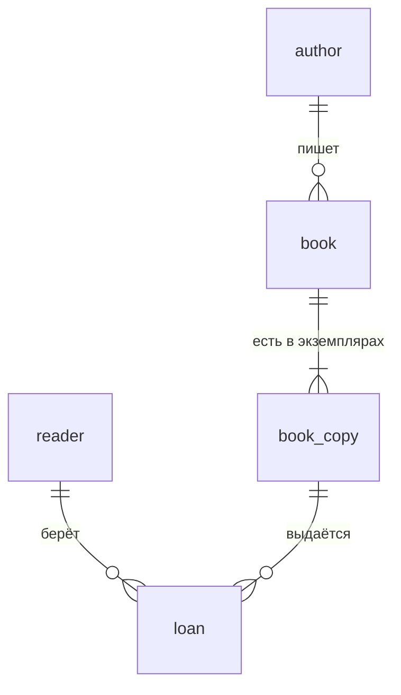
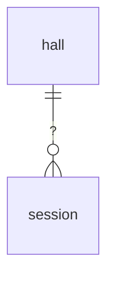

# Обзорная ER-диаграмма

Шаг 0 перед срезами (№66). Только сущности и связи, без колонок: колонки, индексы и ограничения добавляются в своём срезе.

## Как это рисуется (справка)

ER-диаграмма отвечает на два вопроса: **какие сущности есть** (будущие таблицы) и **как они связаны** — сколько строк одной сущности приходится на строку другой. Пример не из нашего домена — библиотека:

Значки на концах линии читаются **от сущности наружу**, у каждой стороны свой:

| Значок | Значит |
|---|---|
| `\|\|` | ровно один |
| `o\|` | ноль или один |
| `}\|` | один или много |
| `}o` | ноль или много |

`author ||--o{ book` читается в обе стороны: у книги **ровно один** автор, у автора **ноль или много** книг. В DDL это превратится во внешний ключ: колонка `author_id` у `book`. **Ключ всегда лежит на стороне «много».**

Отдельная сущность `loan` появилась потому, что связь «читатель — экземпляр» — это «многие ко многим», да ещё со своими данными (когда выдали, когда вернули). Такую связь нельзя положить колонкой ни в одну из двух таблиц.

Имена сущностей пиши латиницей в единственном числе — это будущие имена таблиц.

## Продукт

С 2026-11-23 продукт — сайт одного кинотеатра (№67): зал с креслами — зал и места зала; фильм — мероприятие; фильм в зале в 19:30 — сеанс; кресло на конкретный сеанс (свободно / в резерве / продано) — место сеанса; билет на 7-й ряд на 19:30 — билет. Всё заводит админ кинотеатра, организаторов нет.

## Сущности

Всё, что ниже, ты уже решил в журнале — я только собрал. Строки с «?» — пробелы: решить, нужна ли сущность и как она называется.

| Сущность | Имя | Откуда |
|---|---|---|
| Пользователь (покупатель, админ, контролёр) | `?` | ответ 2, №26 — ? В5 |
| Зал | `hall` | №6, №7 |
| Место зала | `?` | №6, №20 |
| Мероприятие (фильм) | `?` | №13, №67 |
| Сеанс | `session` | №13 |
| Место сеанса | `?` | №20, №21 |
| Тариф | `?` | №8, №29 — ? В3 |
| Заказ | `order` | №20, №46 |
| Попытка оплаты | `payment_attempt` | №34, №41 |
| Журнал webhook | `?` | №32, №34 |
| Билет | `ticket` | №55 |
| История продаж и возвратов | `?` | №20, №30, №59 — ? В4 |
| Возврат | `refund` | №53, №61 |
| Outbox | `outbox` | №40 |
| ? | | что ещё нужно — может, найдёшь сам |

## Связи

Заполни «?»: кардинальность в нотации выше и одну фразу «почему». Порядок от простого к сложному.

| Связь | Кардинальность | Почему |
|---|---|---|
| зал — место зала | ? | |
| мероприятие — сеанс | ? | |
| зал — сеанс | ? | |
| сеанс — место сеанса | ? | |
| место зала — место сеанса | ? | ? В1 |
| пользователь (покупатель) — заказ | ? | |
| заказ — место сеанса | ? | ? В2 |
| заказ — попытка оплаты | ? | |
| заказ — билет | ? | |
| место сеанса — билет | ? | ? В2 |
| сеанс — тариф | ? | ? В3 |
| попытка оплаты — возврат | ? | |
| возврат — история | ? | ? В4 |

Когда таблица заполнена, нарисуй по ней `erDiagram` ниже.

(Строка-пример нужна, чтобы блок рендерился. Поправь кардинальность, если считаешь иначе.)

## Обсуждение

Раунд 1 (2026-11-23).

### В1. Место зала и место сеанса

**Вопрос В1.** По №20 у каждого места в каждом сеансе своя строка. Тогда зачем отдельное «место зала» — что в нём лежит такого, чего нет в месте сеанса? И как одно связано с другим? Подумай о зале на 10 000 мест и 300 сеансах в год.

**Статус:** открыт.

### В2. Заказ, место сеанса и билет

**Вопрос В2.** Резерв живёт на месте сеанса (№20, №21: блокируем строки мест). Кто на кого ссылается: место сеанса на заказ, заказ на места или нужна отдельная сущность между ними? Учти, что место после возврата продаётся в другой заказ, а билет ссылается и на заказ, и на место (№56: уникальность (заказ, место)).

**Статус:** открыт.

### В3. Тарифы

**Вопрос В3.** «Одна цена на сеанс плюс тарифы» (№8), тариф выбирают после резерва для каждого держателя (№29). Тариф — сущность или колонки сеанса? Если сущность — к чему она привязана и кто на неё ссылается?

**Статус:** открыт.

### В4. История

**Вопрос В4.** История продаж и возвратов (№20) пишется в той же транзакции, что продажа или возврат, и снятие с резерва туда же (№30). Возврат ссылается на записи истории (№59). Одна сущность для всех событий места или несколько? На что ссылается запись истории, если билет из рабочей таблицы уже удалён?

**Статус:** открыт.

### В5. Пользователи и роли

**Вопрос В5.** Три роли (ответ 2, №67). Одна сущность «пользователь» с ролью, отдельная сущность на каждую роль или пользователь плюс отдельная сущность ролей? Может ли сотрудник кинотеатра (админ или контролёр) купить билет как покупатель?

**Статус:** открыт.
