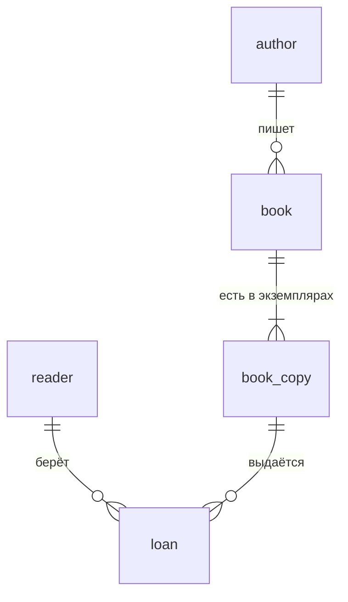
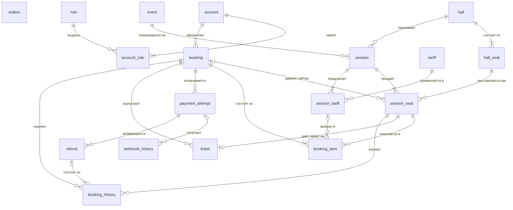

# Обзорная ER-диаграмма

Шаг 0 перед срезами (№66). Только сущности и связи, без колонок: колонки, индексы и ограничения добавляются в своём срезе.

## Как это рисуется (справка)

ER-диаграмма отвечает на два вопроса: **какие сущности есть** (будущие таблицы) и **как они связаны** — сколько строк одной сущности приходится на строку другой. Пример не из нашего домена — библиотека:

Значки на концах линии читаются **от сущности наружу**, у каждой стороны свой:

| Значок | Значит |
|---|---|
| `\|\|` | ровно один |
| `o\|` (слева пишется `\|o`) | ноль или один |
| `}\|` | один или много |
| `}o` | ноль или много |

`author ||--o{ book` читается в обе стороны: у книги **ровно один** автор, у автора **ноль или много** книг. В DDL это превратится во внешний ключ: колонка `author_id` у `book`. **Ключ всегда лежит на стороне «много».**

Отдельная сущность `loan` появилась потому, что связь «читатель — экземпляр» — это «многие ко многим», да ещё со своими данными (когда выдали, когда вернули). Такую связь нельзя положить колонкой ни в одну из двух таблиц.

Имена сущностей — латиницей в единственном числе, snake_case, без зарезервированных слов SQL (`user`, `order`): это будущие имена таблиц.

## Продукт

С 2026-11-23 продукт — сайт одного кинотеатра (№67): зал с креслами — зал и места зала; фильм — мероприятие; фильм в зале в 19:30 — сеанс; кресло на конкретный сеанс (свободно / в резерве / продано) — место сеанса; билет на 7-й ряд на 19:30 — билет. Всё заводит админ кинотеатра, организаторов нет.

## Сущности

| Сущность | Имя |
|---|---|
| Пользователь (покупатель, админ, контролёр) | `account` |
| Роль; пользователь — роль | `role`, `account_role` |
| Зал; место зала | `hall`, `hall_seat` |
| Мероприятие (фильм) | `event` |
| Сеанс; место сеанса | `session`, `session_seat` |
| Тариф (справочник видов); тариф сеанса (цена) | `tariff`, `session_tariff` |
| Заказ; позиция заказа (место, держатель, тариф) | `booking`, `booking_item` |
| Попытка оплаты | `payment_attempt` |
| Журнал webhook | `webhook_history` |
| Билет | `ticket` |
| История событий мест (резерв, продажа, возврат, снятие с резерва) | `booking_history` |
| Возврат | `refund` |
| Outbox | `outbox` |

## Диаграмма

Над каждой линией — комментарий: в какой таблице лежит ключ. `NULL` — ключ может быть пустым.

## Почему так

Все линии проверены одним приёмом (В14): линия `A ||--o{ B` — это утверждение «в таблице B есть колонка `a_id`». Значки по краям читаются из той же колонки:

- **сторона A:** `||` — колонка `a_id` обязательна (`NOT NULL`); `|o` — может быть пустой;
- **сторона B:** `|{` — у каждой строки A есть хотя бы одна строка B; `o{` — может не быть ни одной; `o|` — не больше одной (колонка `a_id` уникальна).

**Посредники** получают «вилки» со всех сторон, потому что ключи лежат в них: `account_role` (аккаунт — роль), `session` (мероприятие — зал), `session_seat` (сеанс — место зала), `session_tariff` (сеанс — тариф), `booking_item` (заказ — место сеанса).

**Справочник и экземпляр сеанса.** Трижды один приём: справочник, одинаковый для всех сеансов (`hall_seat`, `tariff`, `event`), и посредник со своими данными сеанса (`session_seat` — состояние, `session_tariff` — цена, `session` — время и зал).

**«Сейчас» и «всегда».** Место сеанса знает только **текущий** заказ: `session_seat.booking_id` пустой у свободного места, поэтому `|o`. Всё, что было с местом раньше, — в `booking_history` (выписка) и в `booking_item` (что и кому продавали). Так же у билета: на место — не больше одного действующего (`o|`), возвращённые удаляются (№59), след — в истории.

**По линиям, где была путаница:**

| Линия | Ключ | Почему так |
|---|---|---|
| `booking \|o--o{ session_seat` | `session_seat.booking_id`, может быть пустым | У свободного места заказа нет; у заказа после истечения резерва мест «сейчас» нет |
| `session_seat \|\|--o\| ticket` | `ticket.session_seat_id`, уникален | Действующий билет на место — ноль или один (В7) |
| `session_tariff \|o--o{ booking_item` | `booking_item.session_tariff_id`, может быть пустым | Тариф выбирают после резерва (№29), до этого позиция без тарифа |
| `tariff \|\|--o{ session_tariff` | `session_tariff.tariff_id` | Ключ в посреднике, не в справочнике: «детский» — одна строка на все сеансы |
| `refund \|o--\|{ booking_history` | `booking_history.refund_id`, может быть пустым | У возврата одна или много записей «возвращено»; у «продано» и «снято с резерва» возврата нет (В4б) |
| `booking \|\|--o{ booking_history` | `booking_history.booking_id` | Каждое событие места происходит в рамках какого-то заказа; ключ у записи, а не у заказа |
| `hall_seat \|\|--o{ session_seat` | `session_seat.hall_seat_id` | Новый зал ещё без сеансов |
| `booking \|\|--o{ ticket` | `ticket.booking_id` | До оплаты билетов нет |

## Решения ментора

Схему по просьбе автора закончил ментор (2026-11-24, №69); автор принял решения 2026-11-24. Решения, которых раньше не было:

1. **`booking_item` создаётся при резерве**, вместе с заказом: одна позиция на каждое место. Держатель и тариф заполняются на странице оплаты (№29), поэтому `session_tariff_id` пустой до выбора. Плюс: позиции навсегда фиксируют, какие места были в заказе, даже после истечения резерва.
2. **`webhook_history.payment_attempt_id` может быть пустым**: событие с подписью провайдера, но с неизвестным id платежа, записывается в журнал для разбора, а не теряется.
3. **У каждого аккаунта хотя бы одна роль** (`account ||--|{ account_role`): «покупатель» — тоже роль, выдаётся при регистрации.

## К DDL

- Цена в момент покупки: копировать в `booking_item` или брать из `session_tariff` (а если тариф сеанса потом поправят)?
- «Одна цена на сеанс» (№8) теперь живёт в `session_tariff` — нужна ли цена у `session`?
- У `booking_item` и `ticket` одинаковая уникальность (заказ, место) (№56): возможно, одна из них поглотит другую.
- Ключи идемпотентности резерва (№28) и возврата (№63) — колонки `booking` и `refund`.
