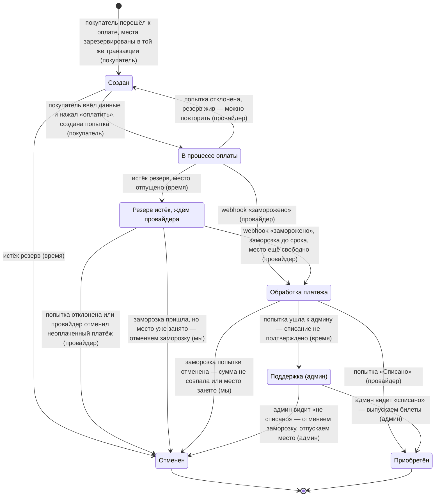

# Состояния заказа

Заказ — покупка до 6 мест на один сеанс (№4). Рождается сразу с резервом мест (№47). Оплата для заказа инкапсулирована: заказ видит только итоги попыток оплаты (`payment.md`), связь — таблица ниже. Возвраты живут на билетах и в отдельной сущности «возврат» (№53), поэтому у заказа нет состояний возврата.

## Переход попытки → что с заказом

| Переход попытки (`payment.md`) | Что с заказом |
|---|---|
| [*] → Создана | Создан → В процессе оплаты |
| Создана → Отклонена, резерв жив | В процессе оплаты → Создан |
| Создана → Отклонена, резерв истёк | Резерв истёк, ждём провайдера → Отменен |
| Создана → Заморожено | В процессе оплаты или Резерв истёк → Обработка платежа |
| … → Списано | Обработка платежа → Приобретён |
| … → Заморозка отменена (основная попытка) | Обработка платежа → Отменен |
| … → Заморозка отменена (вторая заморозка, №37) | не влияет |
| Ретрай списания → Поддержка | Обработка платежа → Поддержка |

## Как читать

- Правила те же, что в `payment.md`: кружок — состояние («заказ сейчас ___»), стрелка — событие, в скобках — источник: (покупатель), (провайдер), (время), (мы), (админ).
- **Место держится** в «Создан» и «В процессе оплаты» до срока резерва; в «Обработке платежа» и «Поддержке» — без срока, пока деньги заморожены или судьба их неясна (№36, №51). В «Резерв истёк, ждём провайдера» место отпущено (№49).
- **Выпуск билетов — не состояние заказа** (№52): факт выпуска — наличие строк билетов. «Приобретён, а билетов нет» находит сверка.
- **«Отменен» конечный.** Оживление после опоздавшей заморозки идёт через «Резерв истёк, ждём провайдера», а не через выход из «Отменен» (№49).

## Отложено на этап проектирования

См. «Вопросы на этап проектирования» в `docs/REQUIREMENTS.md`:
- гонка фонового процесса по сроку и покупателя за один заказ — условия `WHERE` (В4, 9а запроса 4);
- провайдер молчит по заказу в «Резерв истёк, ждём провайдера» — сколько ждём и кто закрывает.

## К DDL

- Статус заказа — колонка с ограниченным набором значений; переходы — условные UPDATE, как в `payment.md`.
- Срок резерва хранится у заказа (или у мест заказа) — от него считают фоновый процесс и проверка №39.
- Смена статуса заказа и запись события в outbox — одна транзакция (№40).
