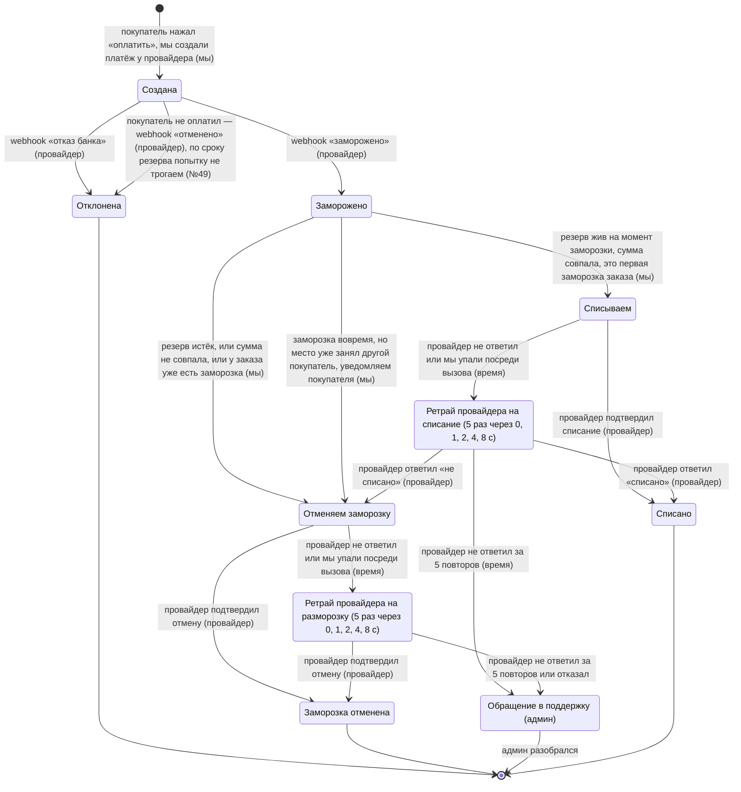

# Состояния попытки оплаты

Попытка оплаты — одна попытка покупателя оплатить заказ у провайдера. У заказа их может быть несколько (№34, №37). Оплата двухстадийная: заморозка, затем списание или отмена заморозки (№31).

## Как читать

- **Кружок — состояние**, положение попытки сейчас. Название читается во фразе «попытка сейчас ___».
- **Стрелка — переход**, подпись — событие, которое его вызывает, в скобках — **источник**: (провайдер), (мы), (время).
- **Состояния на «-ем»** (Списываем, Отменяем заморозку) — «в процессе» из №35: намерение записано в БД до внешнего вызова. Фоновый процесс находит застрявшие в них попытки.
- **Конечные состояния** ведут в `[*]`: из них выхода нет.
- **Возвраты** — отдельная сущность со своими состояниями (№53): по одной попытке может пройти несколько возвратов по разным билетам. Поэтому «Списано» у попытки конечное.
- **Дубли webhook** до диаграммы не доходят: их отсекает журнал по id события (№32).
- **Таймаут — это «не знаем»**, а не «не прошло»: после молчания провайдера деньги не возвращаются и попытка не отклоняется, пока статус не выяснен.
- **Отмена заморозки идемпотентна:** повтор над уже отменённой заморозкой ничего не меняет, поэтому её можно смело повторять.

## Отложено на этап проектирования

См. «Вопросы на этап проектирования» в `docs/REQUIREMENTS.md`:
- событие, для которого нет стрелки из текущего состояния (опоздавший «отказ» в «Списано», «заморожено» в «Отклонена»);
- кто выполняет повторы — обработчик webhook или фоновый процесс.

## К DDL

- Состояние — колонка статуса попытки, ограниченная допустимыми значениями.
- Переход — `UPDATE ... SET статус = новый WHERE id = ? AND статус = старый`. Если затронуто 0 строк, переход уже кто-то сделал или он недопустим из текущего состояния (вопрос 9а запроса 4).
- Для «в процессе» нужно знать, с какого момента попытка в нём, иначе фоновый процесс не отличит застрявшую от обрабатываемой сейчас (вопрос 3в-1а).
- Для повторов нужно знать, сколько их уже было.
