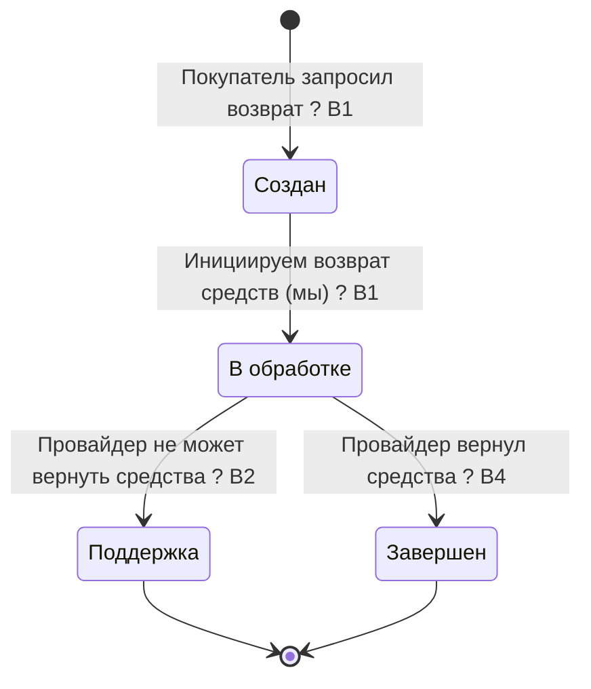

# Состояния возврата

## Обсуждение

Раунды 1–2 (2026-11-20) — одна тема: **внешний вызов и неизвестность**. Метка «? Вn» на стрелке ведёт к блоку.

### Принято до диаграммы (п. 2)

- Возврат N билетов из M одной операцией — **один возврат**, ссылается на N записей истории (№59).
- Отмена сеанса — **один возврат на каждый оплаченный заказ** со всеми его действительными билетами. Ограничение «один заказ на сеанс» не действует: ответ 6 ограничивает только активный резерв, число заказов не ограничено.
- Общее правило: **один возврат = одна операция над одним платежом** (успешной попыткой заказа, №53).

### В1. «Создан» и «В обработке»

**Раунд 1.** Ответ в диаграмме: возврат рождается «Создан» по запросу покупателя, затем «инициируем возврат средств (мы)» → «В обработке».

**Комментарий.** Рождение в «Создан» верное: возврат записывается в транзакции удаления билета (№59), а вызов провайдера идёт после коммита (№35). Два пробела:
1. Стрелка рождения без источника и без второго инициатора — отмены сеанса (мы).
2. Чем «Создан» отличается от «В обработке» для кода? Прогони обе проверки: что писать в БД и когда — до вызова или после? Представь, что сервис упал. Фоновый процесс нашёл возврат в «Создан» — что он делает? А в «В обработке»?

**Вопрос В1.** Нужны ли оба состояния? Если да — назови, что именно разное делает фоновый процесс после падения в каждом из них. Если нет — какое оставить.

**Раунд 2.** Ответ: «В обработке» нужно, чтобы реже обращаться к провайдеру. После падения: возврат в «Создан» — отправляем запрос на возврат; в «В обработке» — ждём webhook от провайдера.

**Комментарий.** Различие поведения названо — это правильный ход проверки. Но есть две нестыковки.
1. С В4: там исход приходит **из ответа на вызов**, а не из webhook. Тогда в «В обработке» после падения ждать нечего — ответ потерян вместе с процессом.
2. Две точки падения. «В обработке» записывается до вызова или после?
   - **До:** записали «В обработке», упали, вызов не ушёл. Фоновый процесс ждёт webhook, которого не будет — деньги покупателю не вернутся никогда.
   - **После:** вызов ушёл и прошёл, упали до записи. Возврат в «Создан» — фоновый процесс шлёт вызов ещё раз. Это В3.

**Вопрос В1а.** Выбери, когда пишется «В обработке» — до или после вызова, и для своего выбора скажи, что делает фоновый процесс с возвратом, застрявшим в «В обработке». Подсказка: в payment.md «Списываем» пишется **до** вызова (№35), и застрявшее «Списываем» не ждёт, а уточняет у провайдера.

**Статус:** открыт.

### В2. Провайдер не ответил

**Раунд 1.** Ответ в диаграмме: из «В обработке» два выхода — «провайдер вернул» и «провайдер не может вернуть» → «Поддержка».

**Комментарий.** Нет третьего исхода, самого частого в жизни: **таймаут**. Провайдер не ответил — деньги вернулись или нет, мы не знаем (№44). Сейчас возврат застрянет в «В обработке» навсегда, либо таймаут ошибочно уйдёт по стрелке «не может вернуть».

**Вопрос В2.** Куда идёт возврат при таймауте? Сравни с payment.md: там на это есть «Ретрай провайдера на списание». Подходит ли та же схема (5 повторов через 0, 1, 2, 4, 8 с, затем админ) или у возврата причины ждать иначе?

**Раунд 2.** Ответ: подходит.

**Комментарий.** Принято, но повторять вызов возврата безопасно только после В3 — иначе каждый повтор рискует вернуть деньги ещё раз.

**Статус:** принят, стрелки добавим вместе с В3.

### В3. Двойной возврат

**Комментарий.** Повтор вызова из В2 — опасное место. Отмена заморозки была идемпотентна сама по себе: отменить уже отменённое — ничего не меняет. Возврат — нет: если первый «верни 1500 ₽» на самом деле прошёл, а мы повторили, провайдер может вернуть ещё 1500 ₽. Платит площадка.

**Вопрос В3.** Что защищает от двойного возврата при повторе? Подсказка: ключ идемпотентности из шага 1 запроса 4. Когда этот ключ должен быть создан — при повторе, при первом вызове или раньше — и где он хранится, чтобы пережить падение сервиса?

**Раунд 2.** Ответа нет.

**Комментарий.** Первая подсказка: ты уже решал эту задачу — №28, идемпотентность резерва. Там клиент присылает ключ, сервер хранит его вместе с резервом, и повтор с тем же ключом возвращает уже созданный резерв, а не создаёт второй. Здесь роли зеркальные: **клиент — мы**, сервер — провайдер. Провайдер хранит наш ключ и на повтор с тем же ключом отвечает «уже вернул», а не возвращает ещё раз.

**Вопрос В3а.** Чтобы повтор после падения прислал **тот же** ключ, когда мы должны его создать и где сохранить? Если создавать новый ключ на каждый вызов — что увидит провайдер на повторе?

**Статус:** открыт.

### В4. Как приходит ответ

**Раунд 1.** Ответ в диаграмме: «провайдер вернул средства» → «Завершен», без источника.

**Вопрос В4.** Откуда мы узнаём, что деньги вернулись: из ответа на наш вызов, из webhook позже или и так, и так? Если возможны оба пути — что будет, когда придут оба (или webhook раньше ответа)? Что из payment.md это уже решает?

**Раунд 2.** Ответ: из ответа на вызов.

**Комментарий.** Принято: наш фейковый провайдер отвечает на возврат синхронно, webhook по возвратам не шлёт. Это упрощает дубли (нечему приходить дважды), но всё молчание теперь — таймаут вызова, то есть В2 и В3. И это меняет В1: ждать после падения нечего.

**Статус:** закрыт. Источник у стрелки «вернул» — (провайдер), ответ на вызов.

## На следующие раунды

- **Выходы из «Поддержки»** (№45): чем может закончиться работа админа.
- **Массовая отмена сеанса** (п. 6): кто создаёт тысячи возвратов — обработчик кнопки или фоновый процесс.
