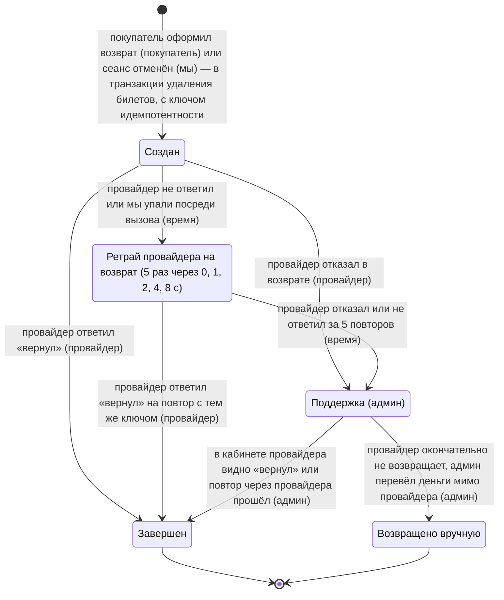

# Состояния возврата

Возврат — одна операция возврата денег по одному платежу (успешной попытке заказа, №53). Покупатель вернул N билетов из M — один возврат; отменён сеанс — по одному возврату на каждый оплаченный заказ (№61). Возврат создаётся в транзакции удаления билетов и ссылается на записи истории возвратов (№59).

## Как читать

- Правила те же, что в `payment.md`.
- **Вызов провайдера идёт из «Создан» после коммита**, итог пишется после ответа (№62). Исход приходит синхронно в ответе на вызов, webhook по возвратам нет; таймаут — «не знаем», 5 повторов, затем админ.
- **Повтор безопасен благодаря ключу идемпотентности** (№63): ключ создаётся один раз в транзакции создания возврата и хранится в его строке. Любой повтор — после рестарта из «Создан» или из «Ретрая» — несёт тот же ключ, и провайдер на знакомый ключ отвечает «уже вернул».
- **«Сколько должны покупателям»** — сумма возвратов в «Создан», «Ретрай» и «Поддержка». «Возвращено вручную» отделено от «Завершен», чтобы на сверке с выпиской провайдера было видно, почему у провайдера нет записи (№65).
- **Массовая отмена сеанса** (№64): обработчик меняет только статус сеанса, возвраты создаёт фоновый процесс порциями. Оставшаяся работа — действительные билеты отменённого сеанса; номер порции не хранится.
- **Гонка «покупатель вернул» и «порция отмены»**: в транзакции первым идёт DELETE билетов, возврат собирается только из реально удалённых строк; второй получает 0 строк и возврат не создаёт.

## К DDL

- Статус возврата — колонка с ограниченным набором значений; переходы — условные UPDATE.
- Ключ идемпотентности — колонка возврата, уникальная.
- Ссылки: возврат → успешная попытка оплаты; записи истории возвратов → возврат.
- Для ретраев — время входа в состояние и счётчик повторов, как у попытки оплаты.
