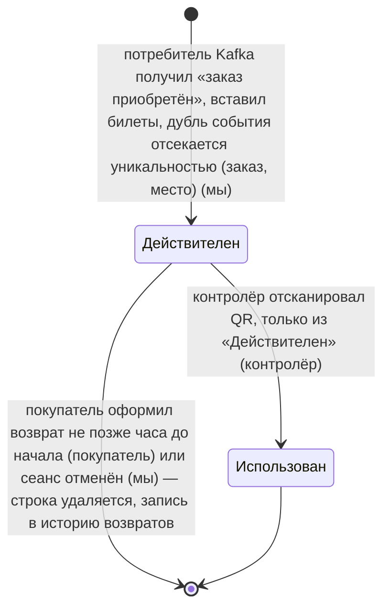

# Состояния билета

Билет — именное право пройти на одно место одного сеанса (№12, ответ 25). Билет ≠ место: у места сеанса своя строка и свой цикл «свободно → в резерве → продано → свободно» (№20). Когда возвращённое место покупает другой человек, это новый билет с другим держателем.

## Как читать

- Правила те же, что в `payment.md` и `order.md`.
- **Проход:** `UPDATE … SET статус = 'использован' WHERE id = ? AND статус = 'действителен'`. Второй одновременный скан получает 0 строк → «билет недействителен» (ответ 27). Время сеанса проверяется тут же.
- **Конец сеанса — не состояние** (№58): непройденный билет не переписывается, «сеанс закончился» вычисляется по времени сеанса.
- **Возврат** удаляет строку билета (№59). В той же транзакции: запись в историю возвратов (№20), создание возврата, который ссылается на эти записи истории, и освобождение места сеанса. Отменить возврат нельзя. Деньги ведёт возврат (`refund.md`), отказ провайдера — к админу на стороне возврата.
- **Срок «не позже часа до начала»** проверяет API: поздний запрос отклоняется, билет не меняется.
- **Перенос сеанса** — не состояние билета: меняется дата сеанса, правило часа считается от новой даты.
- **Отмена сеанса** — та же стрелка возврата для всех действительных билетов, источник — (мы).

## К DDL

- Уникальность (заказ, место) у билета; вставка `INSERT … ON CONFLICT (заказ, место) DO NOTHING`.
- От двух билетов на одно место из разных заказов защищает строка места сеанса, а не билет.
- История возвратов — отдельная таблица; возврат ссылается на её записи.
